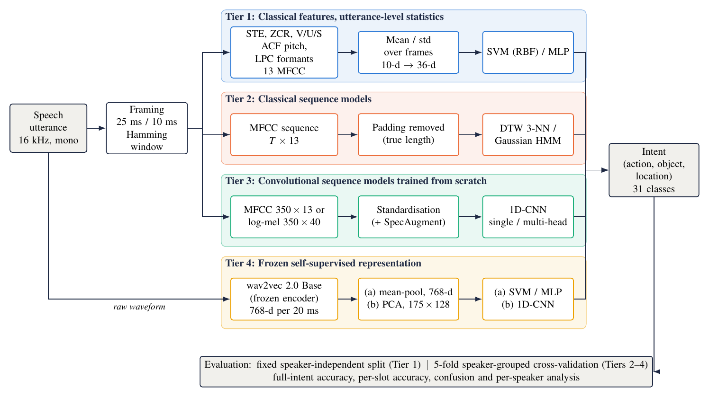
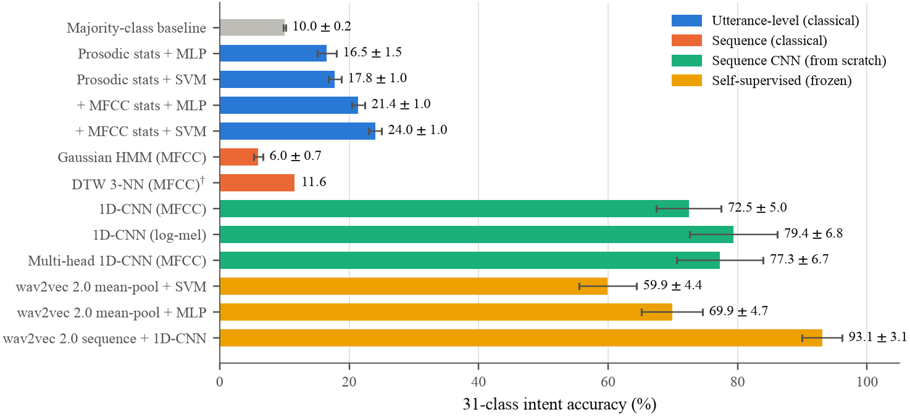
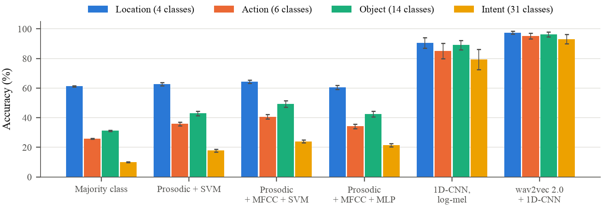

# Speech-to-Action: A Comparative Study of Classical and Deep Learning Approaches for Spoken Intent Classification

Shruti Sivakumar, Vida Nadheera S, Shreya Sriram
Amrita School of Artificial Intelligence, Amrita Vishwa Vidyapeetham, Coimbatore
Course project, 22AIE450 Speech Processing (guide: Dr. Jyothish Lal)

**Documents:** [Report (PDF)](docs/Speech_to_Action_Report.pdf) · [Slides (PDF)](docs/Speech_to_Action_Slides.pdf) · [LaTeX sources](docs/latex/)

## Abstract

Spoken intent classification maps a short voice command directly to a structured action. This project traces how far a progression of speech representations, ordered from short-time acoustic analysis to self-supervised embeddings, carries the task on the Fluent Speech Commands corpus (30,043 utterances, 97 speakers, 31 intents). A classical feature-extraction pipeline (short-time energy, zero-crossing rate, autocorrelation pitch, linear prediction and MFCC) is verified on individual utterances and summarised into utterance-level statistics for SVM and MLP classifiers. Dynamic time warping and per-class Gaussian HMMs serve as classical sequence baselines, one-dimensional CNNs are trained from scratch on MFCC and log-mel sequences, and a frozen wav2vec 2.0 encoder is evaluated with pooled and frame-sequence classifiers. All models are compared under five-fold speaker-grouped cross-validation, on the 31-class task and on reduced-class tasks for the action, object and location slots. Utterance statistics reach 24.0 ± 1.0% on the intent, a log-mel CNN reaches 79.4 ± 6.8%, and the same CNN on frozen wav2vec 2.0 frames reaches 93.1 ± 3.1%. Preserving temporal order contributes more than any change of static feature or any reduction of the label set.

## Method

The study is organised in four tiers that share one input, one label set and one evaluation protocol, and differ only in how the utterance is represented and classified.



| Tier | Representation | Classifier |
|---|---|---|
| 1. Classical, utterance-level | 10 prosodic statistics (energy, ZCR, voicing, F0, formants, duration); + 26 MFCC statistics | SVM (RBF), MLP |
| 2. Classical, sequence | 13-dim MFCC frames, padding removed | DTW 3-nearest neighbours; 3-state Gaussian HMM per intent |
| 3. Deep, trained from scratch | MFCC (350 × 13) or log-mel (350 × 40) frames | 1D-CNN, single-head or multi-head (action / object / location) |
| 4. Self-supervised, frozen | wav2vec 2.0 Base frames (768-d), mean-pooled or PCA-128 sequence | SVM / MLP, or the same 1D-CNN |

**Evaluation.** The official FSC validation and test subsets contain only ten speakers each, which makes single-split estimates unstable (a preliminary CNN scored 84.4% on the test subset but 24–40% on three individual validation speakers). All models are therefore evaluated with five-fold speaker-grouped cross-validation (`GroupKFold` on speaker identity, identical folds for every model and task) and compared by fold-wise paired t-tests.

## Results

### 31-class intent accuracy (5-fold speaker-grouped CV)

| Tier | Model | Accuracy (%) |
|---|---|---|
| — | Majority class | 10.0 ± 0.2 |
| 1 | Prosodic statistics + SVM | 17.8 ± 1.0 |
| 1 | Prosodic + MFCC statistics + SVM | 24.0 ± 1.0 |
| 2 | DTW 3-NN, MFCC (155-query subset of one fold) | 11.6 |
| 2 | Gaussian HMM, MFCC | 6.0 ± 0.7 |
| 3 | 1D-CNN, MFCC | 72.5 ± 5.0 |
| 3 | 1D-CNN, log-mel | 79.4 ± 6.8 |
| 3 | Multi-head 1D-CNN, MFCC (+ SpecAugment) | 77.3 ± 6.7 |
| 4 | wav2vec 2.0 mean-pooled + MLP | 69.9 ± 4.7 |
| 4 | **wav2vec 2.0 frame sequence + 1D-CNN** | **93.1 ± 3.1** |



### Reduced-class slot tasks

| Model | Location (4) | Action (6) | Object (14) | Intent (31) |
|---|---|---|---|---|
| Majority class | 61.2 | 25.8 | 31.2 | 10.0 |
| Prosodic + MFCC statistics + SVM | 64.3 | 40.7 | 49.3 | 24.0 |
| 1D-CNN, log-mel | 90.6 | 85.1 | 89.1 | 79.4 |
| wav2vec 2.0 + 1D-CNN | **97.5** | **95.1** | **96.4** | **93.1** |

Fewer classes raise accuracy for every model, but the utterance-level classifiers remove at most a quarter of the majority-class error on any slot, whereas the sequence models remove 76–95%.



### Principal findings

1. **Prosodic statistics carry little intent information.** Energy, ZCR, pitch, formants and duration reach 17.8%; MFCC statistics add 6.2 points in every fold (p < 0.001).
2. **Temporal order is the largest single factor.** A CNN on the same MFCC frames, with order preserved, reaches 72.5% (+48.5 points over the static MFCC SVM).
3. **The cepstral DCT hurts the CNN.** On identical log-mel frames, an invertible 40-coefficient DCT lowers accuracy from 79.4% to 63.5% (every fold, p < 0.001), and truncation to 13 coefficients partially recovers it (73.1%, equal to standard MFCC). Per-channel standardisation inflates the low-variance high-order coefficients (their standard deviations span a factor of 60, against 2 for the log-mel bands).
4. **A frozen self-supervised representation is the strongest feature once order is preserved.** Mean-pooled wav2vec 2.0 does not beat the MFCC CNN (p = 0.24), but the frame sequence with the same CNN reaches 93.1%, close to the 92.35% reported by SUPERB for frozen wav2vec 2.0 Base.
5. **Residual errors concentrate on commands of opposite polarity** (e.g. *volume up* / *volume down*, *lamp on* / *lamp off*), where a single short particle decides the label, and on a small number of difficult speakers.

## Repository structure

```
speech-to-action/
├── notebooks/                 Executed analysis notebooks, in classical-to-modern order
├── src/
│   ├── config.py              Shared paths and framing parameters
│   ├── features/              Feature extraction over the full corpus (cached under data/)
│   ├── experiments/           Cross-validated training and evaluation of every model
│   └── figures/               Regenerates all figures in results/figures/
├── results/                   Per-fold results (CSV), fold-1 predictions and figures
├── docs/                      Report and slides (PDF) and their LaTeX sources
├── data/fluent_speech_commands_dataset/
│   ├── data/                  Official split metadata (tracked)
│   └── wavs/                  Audio (not tracked; see below)
└── requirements.txt
```

### Notebooks

| Notebook | Content |
|---|---|
| [01](notebooks/01_framing_and_windowing.ipynb) | Loading, framing (25 ms / 10 ms) and Hamming windowing |
| [02](notebooks/02_energy_zcr_voicing.ipynb) | Short-time energy, zero-crossing rate, voiced/unvoiced/silence labelling |
| [03](notebooks/03_pitch_autocorrelation.ipynb) | Pitch estimation by short-time autocorrelation |
| [04](notebooks/04_stft_spectrogram.ipynb) | STFT, narrowband and wideband spectrograms |
| [05](notebooks/05_linear_prediction.ipynb) | Linear prediction (Levinson–Durbin), formants and residual |
| [06](notebooks/06_prosodic_features_svm_mlp.ipynb) | Prosodic utterance statistics with SVM / MLP |
| [07](notebooks/07_mfcc_utterance_features.ipynb) | MFCC utterance statistics |
| [08](notebooks/08_cnn_mfcc_sequences.ipynb) | 1D-CNN on MFCC sequences; motivation for speaker-grouped CV |
| [09](notebooks/09_multihead_cnn_and_classical_baselines.ipynb) | Multi-head CNN; DTW and HMM baselines |
| [10](notebooks/10_cnn_logmel_and_dct_ablation.ipynb) | Log-mel CNN and DCT ablation |
| [11](notebooks/11_wav2vec2_frozen_representations.ipynb) | Frozen wav2vec 2.0: pooled and sequence classifiers |
| [12](notebooks/12_reduced_class_slot_tasks.ipynb) | Reduced-class slot tasks; utterance-level classifiers under CV |

## Reproducing the results

**Environment.** Python 3.13 on CPU (no GPU is required; wav2vec 2.0 is used only as a frozen feature extractor).

```bash
python -m venv venv && source venv/bin/activate
pip install -r requirements.txt
```

**Data.** Download Fluent Speech Commands (Kaggle mirror: [tommyngx/fluent-speech-corpus](https://www.kaggle.com/datasets/tommyngx/fluent-speech-corpus)) and place the `wavs/` folder under `data/fluent_speech_commands_dataset/`. The corpus is distributed under the Fluent Speech Commands Public License (non-commercial, academic use); the audio is not redistributed here.

**Pipeline.** All commands are run from the repository root. Feature caches are written to `data/fluent_speech_commands_dataset/`, and results to `results/`. Approximate CPU run times are given for an 8-core laptop.

```bash
# Feature extraction
python -m src.features.utterance_prosodic       # prosodic statistics (~7 min)
python -m src.features.utterance_mfcc           # + MFCC statistics
python -m src.features.sequence_mfcc            # 350 x 13 MFCC sequences
python -m src.features.sequence_logmel          # 350 x 40 log-mel sequences
python -m src.features.wav2vec2_pooled          # mean-pooled wav2vec 2.0 (~30 min)
python -m src.features.wav2vec2_pca             # PCA 768 -> 128 on training-split frames
python -m src.features.wav2vec2_sequence        # 175 x 128 wav2vec 2.0 sequences

# Experiments (5-fold speaker-grouped CV)
python -m src.experiments.utterance_cv          # Tier 1, all four targets (~5 min)
python -m src.experiments.dtw_baseline          # Tier 2
python -m src.experiments.hmm_baseline          # Tier 2
python -m src.experiments.cnn_mfcc_cv           # Tier 3 (~20 min)
python -m src.experiments.cnn_multihead_cv      # Tier 3
python -m src.experiments.cnn_logmel_cv         # Tier 3
python -m src.experiments.wav2vec2_pooled_cv    # Tier 4
python -m src.experiments.wav2vec2_sequence_cv  # Tier 4 (~15 min)
python -m src.experiments.sequence_cv logmel_dct40 intent   # DCT ablation; inputs: logmel, logmel_dct40,
python -m src.experiments.sequence_cv logmel_dct13 intent   #   logmel_dct13, wav2vec2; targets: intent,
python -m src.experiments.sequence_cv logmel action         #   action, object, location
python -m src.experiments.wav2vec2_fold1_predictions        # predictions for the error analysis

# Figures
python -m src.figures.report_figures
python -m src.figures.slot_task_figures
```

## References

The full bibliography (29 references, each with DOI) is given in the [report](docs/Speech_to_Action_Report.pdf). The principal works are:

- L. Lugosch, M. Ravanelli, P. Ignoto, V. S. Tomar and Y. Bengio, "Speech model pre-training for end-to-end spoken language understanding," *Proc. Interspeech*, 2019. [doi:10.21437/Interspeech.2019-2396](https://doi.org/10.21437/Interspeech.2019-2396)
- A. Baevski, H. Zhou, A. Mohamed and M. Auli, "wav2vec 2.0: A framework for self-supervised learning of speech representations," *Proc. NeurIPS*, 2020. [doi:10.48550/arXiv.2006.11477](https://doi.org/10.48550/arXiv.2006.11477)
- S.-W. Yang *et al.*, "SUPERB: Speech processing universal performance benchmark," *Proc. Interspeech*, 2021. [doi:10.21437/Interspeech.2021-1775](https://doi.org/10.21437/Interspeech.2021-1775)
- S. B. Davis and P. Mermelstein, "Comparison of parametric representations for monosyllabic word recognition in continuously spoken sentences," *IEEE Trans. ASSP*, 1980. [doi:10.1109/TASSP.1980.1163420](https://doi.org/10.1109/TASSP.1980.1163420)
- A. Mohamed, G. Hinton and G. Penn, "Understanding how deep belief networks perform acoustic modelling," *Proc. ICASSP*, 2012. [doi:10.1109/ICASSP.2012.6288863](https://doi.org/10.1109/ICASSP.2012.6288863)

## Citation

```bibtex
@techreport{sivakumar2026speechtoaction,
  author      = {Sivakumar, Shruti and Nadheera S, Vida and Sriram, Shreya},
  title       = {Speech-to-Action: A Comparative Study of Classical and Deep Learning
                 Approaches for Spoken Intent Classification},
  institution = {Amrita School of Artificial Intelligence, Amrita Vishwa Vidyapeetham},
  type        = {Course project report, 22AIE450 Speech Processing},
  year        = {2026}
}
```
